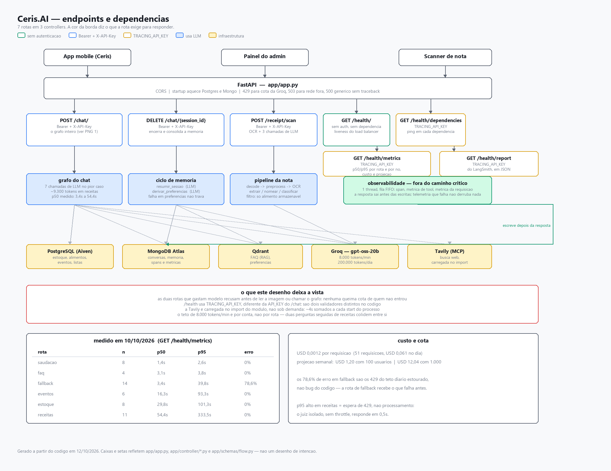
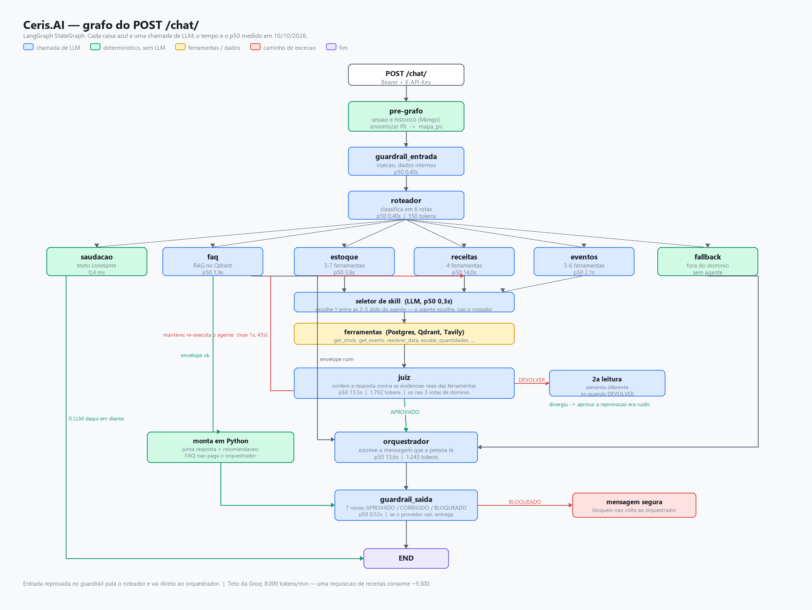
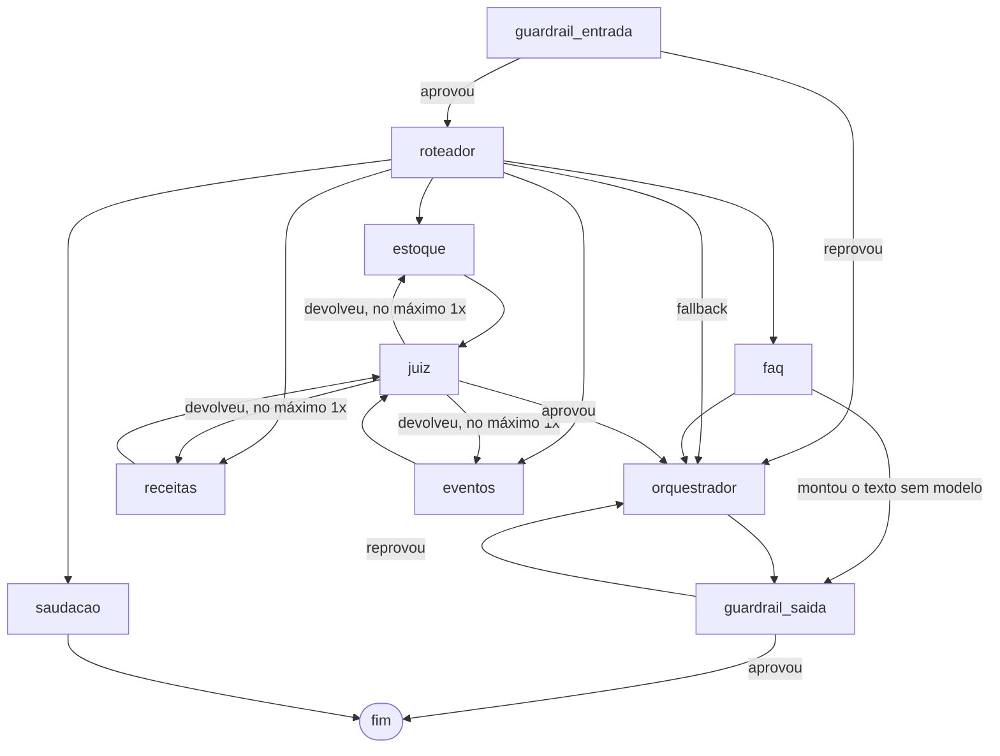

# NexUs-IA-API

Microsserviço de IA do Ceris. Recebe a pergunta que a pessoa digita no
aplicativo e responde sobre o que ela tem em casa: estoque da despensa,
validade, receitas possíveis com o que há, eventos e listas de compra, além
das dúvidas sobre o próprio produto. Também lê nota fiscal por foto e devolve
os itens separados para cadastro.

Não é um prompt único. Cada pergunta atravessa um grafo de agentes (LangGraph)
com guardrail de entrada, roteamento, o agente do domínio com as ferramentas
dele, um juiz que confere a resposta contra a evidência coletada, um
orquestrador que escreve o texto final e um guardrail de saída.

| camada | o que é |
| --- | --- |
| modelo | Groq `openai/gpt-oss-20b` em todos os nós do grafo |
| embeddings | Gemini `gemini-embedding-2-preview`, para o Qdrant |
| despensa | PostgreSQL: itens, produtos, categorias, perfis |
| conversas e domínio | MongoDB: sessões, receitas, eventos, listas, métricas e traces |
| base vetorial | Qdrant: FAQ, documentação, memória e preferências |
| tracing | LangSmith |

## Visão geral

Sete rotas em três controllers, e o que cada uma exige para responder. A
latência e o custo do rodapé são medidos, não estimados: saíram do
`GET /health/metrics` em 10/10/2026.



## Como uma pergunta anda

Cada caixa azul é uma chamada de LLM. No pior caso são sete numa requisição
só, e é daí que vem tanto a latência quanto o teto de tokens por minuto.



<details>
<summary>O mesmo grafo em texto, para editar sem regerar a imagem</summary>



</details>

O que o desenho não diz:

- **O juiz só vê estoque, receitas e eventos.** FAQ responde da base vetorial
  e saudação é texto constante: não há evidência de ferramenta para conferir.
- **A devolução do juiz é uma só** (`LIMITE_DEVOLUCOES = 1`). Cada devolução
  re-executa o agente inteiro, que custa dezenas de segundos; com duas, a
  resposta ia para a casa dos minutos.
- **Saudação não passa por orquestrador nem por guardrail.** O texto é
  constante e nosso, não carrega dado de ninguém para mascarar nem prosa para
  revisar.
- **FAQ pode saltar o orquestrador** quando consegue montar a resposta sem
  modelo, o que corta uma ida ao Groq.
- **Guardrail de saída que reprova devolve ao orquestrador**, não derruba a
  requisição: a resposta é reescrita, e só uma recusa explícita vira mensagem
  de bloqueio.

## Skills

O que cada agente faz num pedido vem de Markdown, não de código:

```
skills/<agente>/<skill>/SKILL.md
```

O frontmatter declara `name`, `description`, `dominio` e `ferramentas`; o
corpo é o roteiro que entra no prompt. A pasta define o dono da skill, e quem
escolhe entre elas é o próprio agente — a escolha costuma depender do que as
ferramentas devolveram, e só ele tem isso na mão.

Ferramenta escrita errada no frontmatter não quebra nada: o loader avisa no
log e segue sem ela. Já aconteceu de três skills de evento declararem
`recomendar_receita` quando a ferramenta real é `recomend_recipe`, deixando a
skill de receitas para evento sem a ferramenta que lhe dá nome. Hoje
`tests/test_skills.py` falha quando isso volta a acontecer.

## Endpoints

| método | rota | autenticação | o que faz |
| --- | --- | --- | --- |
| `POST` | `/chat/` | `X-API-Key` + `Authorization: Bearer` | roda o grafo e devolve `resposta` e `session_id` |
| `DELETE` | `/chat/{session_id}` | `X-API-Key` + `Authorization: Bearer` | encerra a sessão e resume a memória |
| `POST` | `/receipt/scan` | `X-API-Key` + `Authorization: Bearer` | lê a imagem da nota e devolve os itens |
| `GET` | `/health/` | nenhuma | liveness, sem tocar em dependência externa |
| `GET` | `/health/dependencies` | `X-API-Key` | estado de cada dependência externa |
| `GET` | `/health/metrics` | `X-API-Key` | p50, p95, taxa de erro e custo, por rota e por nó |
| `GET` | `/health/report` | `X-API-Key` | relatório a partir do LangSmith, em real |

O `X-API-Key` do `/chat` é conferido contra `API_KEY`; o do `/health` contra
`TRACING_API_KEY`. São chaves diferentes de propósito: o painel do admin não
precisa da chave do aplicativo.

O Bearer é o mesmo JWT que o NexUs-Auth emite, validado aqui pela assinatura
— sem consulta a sessão, a Redis ou ao serviço de autenticação. O `sub` do
token é o perfil, e o que o cliente mandar no corpo para escolher outro é
ignorado: vale para o `account_id` do `/chat` e para a leitura de nota.

As duas rotas que gastam modelo — `/chat/` e `/receipt/scan` — exigem as duas
credenciais, e a recusa vem antes de ler a imagem ou chamar o grafo. Sem isso,
quem tivesse a URL gastava OCR e três idas ao Groq por requisição.

Falha do provedor não vira 500 opaco: cota estourada sai como `429`, rede
caindo como `503`, recusa do Groq como `502`, cada um com a mensagem do
provedor no corpo.

## Rodando

Local, com o `.env` na raiz:

```bash
uvicorn app.app:app --host 0.0.0.0 --port 8000
```

Com Docker:

```bash
docker compose up -d --build
```

A imagem é multi-stage e o `runtime` é o último estágio, então `docker build .`
sem `--target` continua produzindo a imagem de serviço. O compose fixa
`target: runtime` para não depender dessa ordem. A porta publicada vem de
`MS_IA_PORT`, com 8000 como padrão, e o healthcheck é um `curl` em `/health/`
a cada 30s depois de 90s de carência.

A pasta `skills/` vai para dentro da imagem porque o loader lê os `SKILL.md`
do disco. Sem ela, `carregar()` devolve `{}` e o serviço sobe com todo agente
sem roteiro, respondendo `/health/` como se estivesse tudo bem.

O `rapidocr-onnxruntime` arrasta o `opencv-python` com interface gráfica, que
numa imagem slim quebra no `import cv2` por falta de `libxcb`. Por isso o
build desinstala esse e reinstala o `opencv-python-headless` por cima: é o
mesmo `cv2`, sem as bibliotecas de janela que um servidor não tem.

## Testes

```bash
docker compose --profile tests run --rm tests
```

Ou direto, do venv:

```bash
python -m pytest -q tests
```

A suíte não toca a rede: Mongo, Postgres, Groq e as ferramentas entram como
dublês. O `startup` do app checa `pytest` em `sys.modules` e não aquece
conexão nenhuma — antes disso, cada `TestClient` abria handshake com o Aiven e
o Atlas e custava 25s por rodada sem testar nada.

Os módulos novos são `unittest.TestCase`, e `python -m unittest discover -s tests`
roda essa parte. Quatro módulos antigos são de função e só rodam sob pytest,
que é por isso o runner do estágio `tests`.

Um teste está marcado como `expectedFailure` de propósito, para a lacuna que
ele descreve ficar visível no relatório em vez de sumir num comentário.

Fora da suíte, e só para rodar à mão porque gastam cota de verdade:
`tests/bateria_qualidade.py` (alucinação, juiz e qualidade da resposta, por
bloco em `argv`) e `tests/varredura_rotas.py` (varre todas as rotas do
`/chat`).

## Variáveis de ambiente

| variável | para quê |
| --- | --- |
| `GROQ_API_KEY` | modelo de todos os nós do grafo |
| `GEMINI_API_KEY` | embeddings do Qdrant |
| `PGSQL_URL` | despensa |
| `MONGODB_URI` | conversas, domínio, métricas e traces |
| `QDRANT_DATABASE_URL`, `QDRANT_API_KEY` | base vetorial |
| `JWT_SECRET_KEY` | os mesmos bytes do NexUs-Auth: hex de 64 caracteres ou Base64, nunca menos de 32 bytes |
| `JWT_ALGORITHM`, `JWT_ISSUER` | padrão `HS256` e `nexus-auth` |
| `API_KEY` | chave do `X-API-Key` no `/chat`; aceita lista separada por vírgula, para rotação |
| `TRACING_API_KEY` | chave do `X-API-Key` no `/health` |
| `VALID_TOKENS` | atalho de desenvolvimento: tokens aceitos sem conferir assinatura. Vazio em produção |
| `TAVILY_API_KEY` | busca na web, via MCP |
| `LANGCHAIN_API_KEY`, `LANGCHAIN_PROJECT`, `LANGSMITH_WORKSPACE_ID` | tracing |
| `RECEIPT_TEXT_MODEL`, `RECEIPT_VISION_MODEL`, `RECEIPT_MAX_UPLOAD_MB`, `RECEIPT_MAX_CONCURRENCY` | leitura de nota |
| `DOC_FILE_PATH`, `FAQ_FILE_PATH` | só os scripts de injeção |
| `MS_IA_PORT` | porta publicada pelo compose |

Sem `JWT_SECRET_KEY` ou `API_KEY` o serviço não sobe, de propósito: faltando a
chave, toda requisição tomaria 401 dizendo que a chave é inválida, e o erro
pareceria do cliente em vez de configuração.

## Scripts

Rodados à mão, fora da API, e por isso fora da imagem:

```bash
python scripts/qdrant_injection.py          # FAQ na base vetorial
python scripts/doc_injection.py             # documentação em PDF
python scripts/scan_receipt.py nota.png     # leitor de nota pela linha de comando
```

As bases que eles consomem ficam em `scripts/bases/`.

## Observabilidade

Trace por nó no LangSmith e métricas no MongoDB, as duas escritas fora do
caminho crítico: um `ThreadPoolExecutor` de um único worker, FIFO, com flush
limitado no encerramento. A gravação síncrona chegava a ser dois terços do
tempo de uma saudação.

`/health/metrics` é o que o painel do admin consome: p50 e p95 por rota e por
nó do grafo, taxa de erro, custo por requisição e projeção semanal. Só JSON —
a apresentação é do painel.

## Limites conhecidos

- **Cota do Groq.** No plano livre são 8.000 tokens por minuto e 200.000 por
  dia. Uma requisição de chat com orquestrador fica na casa dos 9.000, ou
  seja, estoura o minuto sozinha. Quando isso acontece o cliente espera o
  `retry-after` e a demora aparece como latência, sem erro no log.
- `ALLOWED_TYPES` do leitor de nota aceita `application/octet-stream`, porque
  é o que alguns clientes mandam para imagem. Na prática, qualquer binário
  passa pela primeira peneira e só morre adiante, ao tentar abrir.
- `/health/report` lê do LangSmith e `/health/metrics` do Mongo. Medem a mesma
  coisa por caminhos diferentes, cada um com o seu cálculo de percentil, e
  podem divergir no painel.
- `evento-gerenciar` é a skill padrão de eventos e pode cancelar evento: o
  seletor falhando deixa um palpite com poder de escrita. É a lacuna marcada
  como `expectedFailure` em `tests/test_skills.py`.
- O MCP do Tavily carrega na importação, o que custa alguns segundos por
  processo que sobe.
