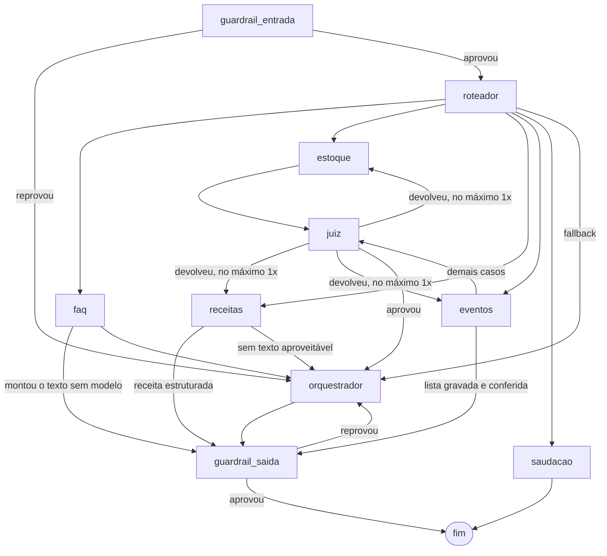

# NexUs-IA-API

Microsserviço de IA do Ceris. Recebe a pergunta que a pessoa digita no
aplicativo e responde sobre o que ela tem em casa: estoque da despensa,
validade, receitas possíveis com o que há, eventos e listas de compra, além
das dúvidas sobre o próprio produto. Também lê nota fiscal por foto e devolve
os itens separados para cadastro.

Não é um prompt único. Cada pergunta atravessa um grafo de agentes (LangGraph)
com guardrail de entrada, roteamento, o agente do domínio com as ferramentas
dele, um juiz que confere a resposta contra a evidência coletada, um
orquestrador que escreve o texto final e um guardrail de saída.

| camada | o que é |
| --- | --- |
| modelo | Groq `openai/gpt-oss-20b` em todos os nós do grafo |
| embeddings | Gemini `gemini-embedding-2-preview`, para o Qdrant |
| despensa | PostgreSQL: itens, produtos, categorias, perfis |
| conversas e domínio | MongoDB: sessões, receitas, eventos, listas, métricas e traces |
| base vetorial | Qdrant: FAQ, documentação, memória e preferências |
| tracing | LangSmith |

## Visão geral

As rotas da API e o que cada uma exige para responder. A latência e o custo do
rodapé são medidos, não estimados: saíram das métricas do Mongo em 10/10/2026,
antes de o painel mudar para `/admin`.


## Como uma pergunta anda

Cada caixa azul é uma chamada de LLM. No pior caso são sete numa requisição
só, e é daí que vem tanto a latência quanto o teto de tokens por minuto.


<details>
<summary>O mesmo grafo em texto, para editar sem regerar a imagem</summary>



</details>

O que o desenho não diz:

- **O juiz usa Jev nas rotas que exigem revisão semântica.** Receitas estruturadas
  e listas confirmadas continuam nos caminhos de validação e renderização diretas;
  FAQ e saudação também preservam seus caminhos próprios.
- **Há uma única correção semântica por pedido**, compartilhada entre a confirmação
  de escrita e o juiz. Após escrita confirmada ou incerta, a correção só pode ler
  ou reutilizar o recibo existente: não executa outra criação com argumentos novos.
- **Saudação não passa por orquestrador nem por guardrail.** O texto é
  constante e nosso, não carrega dado de ninguém para mascarar nem prosa para
  revisar.
- **FAQ pode saltar o orquestrador** quando consegue montar a resposta sem
  modelo, o que corta uma ida ao Groq.
- **Saída aprovada e segura pelo Jev é preservada**, passando pela máscara
  determinística de PII sem nova redação. Nos demais caminhos a revisão existente
  permanece; bloqueios entregam a mensagem segura e encerram.

## Skills

O que cada agente faz num pedido vem de Markdown, não de código:

```
skills/<agente>/<skill>/SKILL.md
```

O frontmatter declara `name`, `description`, `dominio` e `ferramentas`; o
corpo é o roteiro que entra no prompt. A pasta define o dono da skill, e quem
escolhe entre elas é o próprio agente — a escolha costuma depender do que as
ferramentas devolveram, e só ele tem isso na mão.

Ferramenta escrita errada no frontmatter não quebra nada: o loader avisa no
log e segue sem ela. Já aconteceu de três skills de evento declararem
`recomendar_receita` quando a ferramenta real é `recomend_recipe`, deixando a
skill de receitas para evento sem a ferramenta que lhe dá nome. Hoje
`tests/test_skills.py` falha quando isso volta a acontecer.

O chat de estoque consulta produtos, acompanha validade e remove itens com
autorização. Nenhum agente adiciona produtos ao estoque pelo chat. A inclusão
continua pelas telas do aplicativo, por cadastro manual, código de barras ou
foto da nota fiscal.

## Endpoints

| método | rota | autenticação | o que faz |
| --- | --- | --- | --- |
| `POST` | `/chat/` | `X-API-Key` + `Authorization: Bearer` | roda o grafo e devolve `resposta` e `session_id` |
| `DELETE` | `/chat/{session_id}` | `X-API-Key` + `Authorization: Bearer` | encerra a sessão e resume a memória |
| `POST` | `/receipt/scan` | `X-API-Key` + `Authorization: Bearer` | lê a imagem da nota e devolve os itens |
| `GET` | `/health/` | nenhuma | liveness, sem tocar em dependência externa |
| `GET` | `/admin/session` | `X-Admin-Key` | confirma a chave no login do painel |
| `GET` | `/admin/metrics?dias=7` | `X-Admin-Key` | a página da IA no painel, a partir do Mongo |
| `GET` | `/admin/report?dias=7` | `X-Admin-Key` | o período contra o período anterior de mesmo tamanho |
| `GET` | `/admin/langsmith?dias=7` | `X-Admin-Key` | execuções por dia, p50/p99 por chain e agente, feedback e custo em real |
| `GET` | `/admin/dependencies` | `X-Admin-Key` | estado de cada dependência externa |

O `X-API-Key` do `/chat` é conferido contra `API_KEY`. As rotas `/admin` usam
outra chave, no header `X-Admin-Key`, conferida contra `ADMIN_API_KEY`: é a
mesma em todos os serviços do NexUs, para o painel do administrador entrar uma
vez só. São chaves diferentes de propósito: o painel não precisa da chave do
aplicativo, e a chave do aplicativo não abre o painel. O contrato das rotas
está em [Painel do administrador](docs/painel-admin.md).

O Bearer é o mesmo JWT que o NexUs-Auth emite, validado aqui pela assinatura
— sem consulta a sessão, a Redis ou ao serviço de autenticação. O `sub` do
token é o perfil, e o que o cliente mandar no corpo para escolher outro é
ignorado: vale para o `account_id` do `/chat` e para a leitura de nota.

As duas rotas que gastam modelo — `/chat/` e `/receipt/scan` — exigem as duas
credenciais, e a recusa vem antes de ler a imagem ou chamar o grafo. Sem isso,
quem tivesse a URL gastava OCR e três idas ao Groq por requisição.

Falha do provedor não vira 500 opaco: cota estourada sai como `429`, rede
caindo como `503`, recusa do Groq como `502`, cada um com a mensagem do
provedor no corpo.

## Rodando

Local, com o `.env` na raiz:

```bash
uvicorn app.app:app --host 0.0.0.0 --port 8000
```

Com Docker:

```bash
docker compose up -d --build
```

A imagem é multi-stage e o `runtime` é o último estágio, então `docker build .`
sem `--target` continua produzindo a imagem de serviço. O compose fixa
`target: runtime` para não depender dessa ordem. A porta publicada vem de
`MS_IA_PORT`, com 8000 como padrão, e o healthcheck é um `curl` em `/health/`
a cada 30s depois de 90s de carência.

A pasta `skills/` vai para dentro da imagem porque o loader lê os `SKILL.md`
do disco. Sem ela, `carregar()` devolve `{}` e o serviço sobe com todo agente
sem roteiro, respondendo `/health/` como se estivesse tudo bem.

O `rapidocr-onnxruntime` arrasta o `opencv-python` com interface gráfica, que
numa imagem slim quebra no `import cv2` por falta de `libxcb`. Por isso o
build desinstala esse e reinstala o `opencv-python-headless` por cima: é o
mesmo `cv2`, sem as bibliotecas de janela que um servidor não tem.

## Testes

```bash
docker compose --profile tests run --rm tests
```

Ou direto, do venv:

```bash
python -m pytest -q tests
```

A suíte não toca a rede: Mongo, Postgres, Groq e as ferramentas entram como
dublês. O `startup` do app checa `pytest` em `sys.modules` e não aquece
conexão nenhuma — antes disso, cada `TestClient` abria handshake com o Aiven e
o Atlas e custava 25s por rodada sem testar nada.

Os módulos novos são `unittest.TestCase`, e `python -m unittest discover -s tests`
roda essa parte. Quatro módulos antigos são de função e só rodam sob pytest,
que é por isso o runner do estágio `tests`.

Um teste está marcado como `expectedFailure` de propósito, para a lacuna que
ele descreve ficar visível no relatório em vez de sumir num comentário.

Fora da suíte, e só para rodar à mão porque gastam cota de verdade:
`tests/bateria_qualidade.py` (alucinação, juiz e qualidade da resposta, por
bloco em `argv`) e `tests/varredura_rotas.py` (varre todas as rotas do
`/chat`).

## Variáveis de ambiente

| variável | para quê |
| --- | --- |
| `GROQ_API_KEY` | modelos Groq, conforme provedor principal/reserva configurado |
| `GEMINI_API_KEY` | modelos Gemini e embeddings do Qdrant |
| `LLM_PROVIDER`, `LLM_MODEL`, `LLM_FALLBACK_PROVIDER` | provedor/modelo principal e provedor de reserva |
| `TYPESAFE_API_KEY` | autenticação do avaliador Jev; nunca enviada ao frontend |
| `JUDGE_PROVIDER` | `jev` quando há chave TypeSafe, senão `llm`; permite escolher o avaliador |
| `JEV_MODEL` | alias do modelo Jev, padrão `jev-latest`; a versão efetiva aparece nos logs |
| `PGSQL_URL` | despensa |
| `MONGODB_URI` | conversas, domínio, métricas e traces |
| `QDRANT_DATABASE_URL`, `QDRANT_API_KEY` | base vetorial |
| `JWT_SECRET_KEY` | os mesmos bytes do NexUs-Auth: hex de 64 caracteres ou Base64, nunca menos de 32 bytes |
| `JWT_ALGORITHM`, `JWT_ISSUER` | padrão `HS256` e `nexus-auth` |
| `API_KEY` | chave do `X-API-Key` no `/chat`; aceita lista separada por vírgula, para rotação |
| `ADMIN_API_KEY` | chave do painel (`X-Admin-Key`), a mesma em todos os serviços; `TRACING_API_KEY` continua aceita no lugar |
| `VALID_TOKENS` | atalho de desenvolvimento: tokens aceitos sem conferir assinatura. Vazio em produção |
| `TAVILY_API_KEY` | busca na web, via MCP |
| `LANGCHAIN_API_KEY`, `LANGCHAIN_PROJECT`, `LANGSMITH_WORKSPACE_ID` | tracing |
| `RECEIPT_TEXT_MODEL`, `RECEIPT_VISION_MODEL`, `RECEIPT_MAX_UPLOAD_MB`, `RECEIPT_MAX_CONCURRENCY` | leitura de nota |
| `DOC_FILE_PATH`, `FAQ_FILE_PATH` | só os scripts de injeção |
| `MS_IA_PORT` | porta publicada pelo compose |

Sem `JWT_SECRET_KEY` ou `API_KEY` o serviço não sobe, de propósito: faltando a
chave, toda requisição tomaria 401 dizendo que a chave é inválida, e o erro
pareceria do cliente em vez de configuração.


## Receitas salvas e listas de compras

O agente só salva receitas quando a pessoa pede. O documento em `recipes`
preserva ingredientes com nome e quantidade, modo de preparo, `account_id`,
`created_at` em UTC, `preparation_time_minutes` (minutos positivos) e
`difficulty` (`easy`, `medium`, `hard`). Registros antigos sem esses
metadados continuam legíveis; valores ausentes não são inventados.

Listas são gravadas em `shopping_list`, no campo `array_list`, compatível
com o Core. Os itens preservam id, nome, quantidade, unidade e `checked`.
Consultas e alterações filtram a casa autenticada; é possível buscar pelo
título e renomear sem substituir os itens.

`ingredientes_para_comprar` soma lotes válidos e calcula somente quantidades
comparáveis. Por exemplo, 150 g na receita e 100 g disponíveis resultam em
50 g para comprar. Medidas sem equivalência são sinalizadas para conferência.
Uma lista só é confirmada após retorno da gravação; seu texto é montado a
partir dos dados salvos. Gravações equivalentes na mesma requisição não
são repetidas durante revisões do agente.

## Scripts

Rodados à mão, fora da API, e por isso fora da imagem:

```bash
python scripts/qdrant_injection.py          # FAQ na base vetorial
python scripts/doc_injection.py             # documentação em PDF
python scripts/scan_receipt.py nota.png     # leitor de nota pela linha de comando
```

As bases que eles consomem ficam em `scripts/bases/`. A recarga usa IDs
estáveis, publica todos os lotes e somente depois remove os documentos
obsoletos da respectiva coleção (`nexus_faqs` ou `nexus_docs`). Reexecutar não
acumula duplicatas. Uma falha de upload preserva os documentos anteriores.
As coleções de memória e preferências não são alteradas. O PDF normativo
possui uma cópia de texto em `scripts/bases/NexUs_doc.txt` para revisão.

## Observabilidade

Trace por nó no LangSmith e métricas no MongoDB, as duas escritas fora do
caminho crítico: um `ThreadPoolExecutor` de um único worker, FIFO, com flush
limitado no encerramento. A gravação síncrona chegava a ser dois terços do
tempo de uma saudação.

`/admin/metrics` é o que o painel do admin consome: p50 e p95 por rota, tempo
de cada etapa do grafo, leitura de nota, tokens contra a cota diária, custo por
modelo, 429 do Groq por hora, decisões do juiz, bloqueios dos guardrails e
chamadas de cada tool. Só JSON — a apresentação é do painel.

Para isso cada requisição grava, além do tempo e dos tokens, o modelo, o tipo
do erro, a decisão do juiz (`aprovado`, `devolvido` ou `nao_confirmado`)
e se o guardrail de entrada ou de saída bloqueou. A
leitura de nota grava uma métrica com a rota `nota_fiscal`, que fica fora do
volume do chat.

## Jev, retries e controle de alucinações

O cliente de `app/core/jev_client.py` usa o endpoint oficial TypeSafe, pool de
conexões e uma chamada com quatro critérios: lastro (Choice), fidelidade (Score
de 0 a 2), relevância e segurança (Noul). Score, confiança e probabilidade têm
significados distintos. Os limiares iniciais são conservadores, não uma promessa
de acurácia calibrada: aprovação exige lastro apoiado com probabilidade ≥ 0,8,
confiança ≥ 0,6, fidelidade normalizada ≥ 0,85, confiança do score ≥ 0,5,
relevância ≥ 0,7 e segurança ≥ 0,9.

Antes do score, código verifica recibos de ações anunciadas. Pedido, argumentos
da chamada, `false`, `null` e falha de ferramenta não são prova de gravação.
Incerteza ou falha do Jev escala uma única vez ao LLM; indisponibilidade ou
veredito inválido não aprovam a resposta. Reprovação após o único reparo encerra
com mensagem honesta, sem novos ciclos.

O Jev tem no máximo duas tentativas, orçamento entre tentativas de 5 s, backoff
com jitter e respeito a `Retry-After`. Só erros transitórios de transporte/HTTP
408, 429, 5xx previstos e 529 são repetidos. Erros 400/401/403/422 e payload
inválido não são repetidos. Após três falhas consecutivas, o circuito abre por
30 s e permite uma sondagem de recuperação. Timeouts são de I/O; isso não é um
prazo absoluto para todo o chat nem para cada byte de uma conexão lenta.

Nos LLMs, retries dos SDKs ficam desativados. Há no máximo uma troca de provedor
em falha transitória; erro de configuração/validação não dispara fallback.
O agente tem limite de 16 passos do grafo, e esgotamento transitório dos provedores
entrega resposta controlada. Leituras de estoque são reutilizadas apenas dentro
da requisição e invalidadas após escrita; preferências e restrições independentes
são lidas em paralelo. Restrição indisponível não significa ausência de alergias.

Um orçamento compartilhado permite no máximo 12 chamadas aos LLMs por pedido,
incluindo fallback, com janela de 60 s para iniciar chamadas. Uma chamada não
começa se seu timeout configurado não cabe no tempo restante. Isso limita ciclos
e esperas acumuladas, mas não cancela uma escrita em andamento nem promete prazo
absoluto para I/O de banco, MCP ou outros serviços externos.

As proteções de escrita são locais à requisição/processo. Não garantem execução
única entre reinícios, réplicas ou reenvios HTTP independentes. Erro de conexão
com resultado de escrita ambíguo bloqueia repetição automática e pede consulta
dos registros. Não há rollback automático de uma ação já executada.

`judge_usage` registra tokens TypeSafe separadamente, sem aplicar a eles a tarifa
estimada dos LLMs. Logs do juiz contêm fonte, versão, scores e decisão. Os casos
sintéticos versionados estão em `tests/fixtures/judge_cases.json` e
`tests/fixtures/judge_adversarial_cases.json`; os testes offline não consomem API.

## Validação antes da gravação e privacidade

Eventos exigem data válida, duração e participantes inteiros positivos, descrição
e local. Receitas exigem quantidades culinárias positivas com unidade reconhecida;
frações e medidas explícitas como “a gosto” são preservadas, sem conversão estimada.
Objetos, booleanos, valores não finitos e quantidades negativas não são aceitos.
As ferramentas validam antes da escrita e os repositórios revalidam antes do insert;
essas regras não alteram a leitura de documentos antigos.

Erro de validação pede correção dos dados antes de salvar. A revisão posterior do
juiz não substitui essa proteção e não desfaz gravações.

Ter lastro nas evidências não autoriza divulgar dados privados de outra conta.
Jev e o juiz de reserva recebem essa regra; telefone, CPF e e-mail em claro também
recebem veto determinístico com os mesmos padrões usados na saída. Essa checagem
não substitui a autorização por conta e sessão nem detecta toda possível
ofuscação de dados pessoais.

## Limites conhecidos

- **Cotas externas.** Os provedores podem limitar tokens e requisições. Jev e
  redução de chamadas não removem essas cotas. Depois da única troca transitória,
  esgotamento encerra o pedido com resposta controlada em vez de aguardar retries
  aninhados; consulte os limites contratados de cada conta.
- `ALLOWED_TYPES` do leitor de nota aceita `application/octet-stream`, porque
  é o que alguns clientes mandam para imagem. Na prática, qualquer binário
  passa pela primeira peneira e só morre adiante, ao tentar abrir.
- `/admin/langsmith` lê do LangSmith e `/admin/metrics` do Mongo. Medem a mesma
  coisa por caminhos diferentes, cada um com o seu cálculo de percentil, e
  podem divergir no painel.
- O 429 contado no painel é o que chegou ao fim da requisição; uma falha absorvida
  pela troca de provedor deve ser investigada nos traces, não só no total de erros.
- `evento-gerenciar` é a skill padrão de eventos e pode cancelar evento: o
  seletor falhando deixa um palpite com poder de escrita. É a lacuna marcada
  como `expectedFailure` em `tests/test_skills.py`.
- O MCP do Tavily carrega na importação, o que custa alguns segundos por
  processo que sobe.
